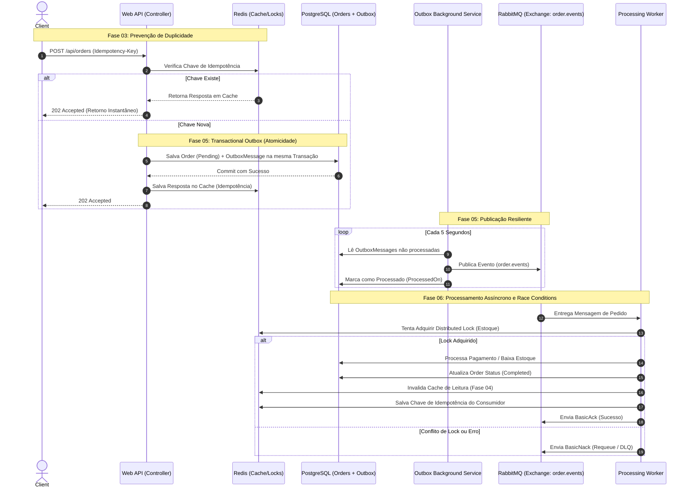

# 🚀 Order & Payment Processing Engine


## 📌 Visão Geral

Este projeto é um motor de processamento de pedidos e pagamentos concebido para demonstrar **alta disponibilidade, resiliência e consistência eventual** em arquiteturas distribuídas. 

Construído sob os princípios da **Clean Architecture** e **Domain-Driven Design (DDD)**, o sistema não é apenas um CRUD, mas um ecossistema tolerante a falhas que resolve problemas clássicos de engenharia de software em larga escala:
- **Prevenção de Duplo Faturamento (Double-Spend):** Implementação de Filtros de Idempotência interceptando requisições com Redis.
- **Proteção de Base de Dados (Cache Stampede):** Leituras otimizadas utilizando Cache-Aside com TTL Jitter e Distributed Locks (Mutex).
- **Garantia de Entrega Atômica (At-Least-Once):** Padrão **Transactional Outbox** garantindo que eventos de domínio sejam salvos na mesma transação ACID do EF Core e despachados assincronamente para o Message Broker.
- **Controlo de Concorrência (Race Conditions):** Consumidores competidores (*Workers*) que utilizam Distributed Locks no Redis para garantir integridade do *stock* durante o processamento de pagamentos.

## 🛠 Stack Tecnológica

- **Backend:** C# com .NET 8 (Web API & Worker Services).
- **Arquitetura:** Clean Architecture, CQRS (via MediatR), DDD Tático.
- **Persistência Relacional:** PostgreSQL + Entity Framework Core (Fluent API, Migrations).
- **Cache & Concorrência:** Redis (StackExchange.Redis, IDistributedCache).
- **Mensageria Assíncrona:** RabbitMQ (Fanout Exchanges, Dead Letter Queues - DLQ).
- **Infraestrutura:** Docker & Docker Compose.

## 🏗 Arquitetura e Fluxo de Resiliência

O diagrama abaixo ilustra o ciclo de vida completo de um pedido, evidenciando as barreiras de proteção arquitetural implementadas.



## 🛤 Histórico de Fases e Branches

O projeto foi construído evolutivamente através de *Spec-Driven Development (SDD)*, garantindo governança estrita em cada etapa:

*   **Fase 01 (`feature/01-infra-setup`):** Configuração do ambiente Docker Compose (Postgres, Redis, RabbitMQ) e *scaffold* da Clean Architecture.
*   **Fase 02 (`feature/02-domain-core`):** Modelagem rica do domínio (DDD), encapsulamento de entidades, repositórios e mapeamento do EF Core via Fluent API.
*   **Fase 03 (`feature/03-api-idempotency`):** Implementação da Web API fina utilizando CQRS (MediatR) e criação do `IdempotencyFilterAttribute` com Redis.
*   **Fase 04 (`feature/04-cache-resilience`):** Otimização de leitura (GET) com Cache-Aside, mitigação de *Cache Stampede* (Jitter) e Fallback para a Base de Dados.
*   **Fase 05 (`feature/05-transactional-outbox`):** Implementação do padrão *Transactional Outbox* para garantir entrega atômica de eventos (RabbitMQ) sem perda de dados.
*   **Fase 06 (`feature/06-async-worker`):** Criação do serviço consumidor em *background* utilizando *Distributed Locks* no Redis para controlo de *stock* e Dead Letter Exchanges (DLX) para falhas.

## 🚀 Como Executar Localmente

### Pré-requisitos
- [Docker Desktop](https://www.docker.com/products/docker-desktop/) em execução.
- [.NET 8 SDK](https://dotnet.microsoft.com/download/dotnet/8.0) instalado.

### Passos
1. **Suba a infraestrutura:**
   Na raiz do projeto, execute:
   ```bash
   docker-compose up -d
   ```
   *Serviços disponíveis:* PostgreSQL (5432), Redis (6379), RabbitMQ (5672) e Painel de Gestão RabbitMQ (`http://localhost:15672`).

2. **Execute as Migrações da Base de Dados:**
   ```bash
   dotnet ef database update --project OrderEngine.Infrastructure/OrderEngine.Infrastructure.csproj --startup-project OrderEngine.Api/OrderEngine.Api.csproj
   ```

3. **Inicie a Web API:**
   ```bash
   dotnet run --project OrderEngine.Api/OrderEngine.Api.csproj
   ```
   *Acesse o Swagger em:* `http://localhost:<porta>/swagger`

4. **Inicie o Background Worker (Num novo terminal):**
   ```bash
   dotnet run --project OrderEngine.Worker/OrderEngine.Worker.csproj
   ```

*(Experimente criar um pedido no Swagger com um `Idempotency-Key` e observe a magia da comunicação assíncrona nos terminais!)*